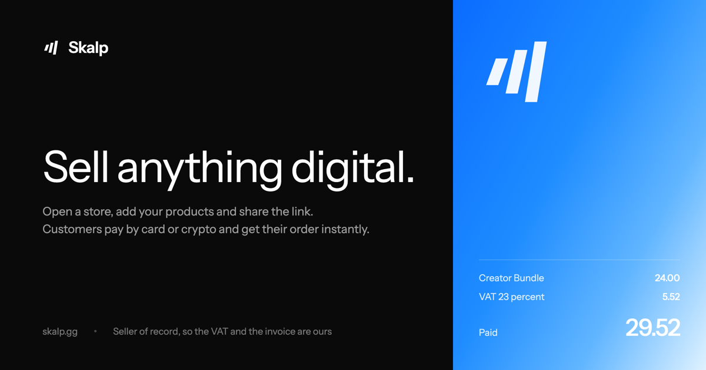

<p align="center">
  <a href="https://skalp.gg"></a>
</p>

Skalp is a merchant-of-record payment platform for software and digital products. Sell through a hosted store or call the API from your own app. Buyers pay by card or crypto in their own currency and get their files and license keys right after payment. Skalp issues the invoices, handles VAT and pays out to your bank in more than 40 countries.

## Node.js and edge runtimes

Runs on Node 20+, Bun, Deno, Vercel Edge and Cloudflare Workers.

```sh
npm install @skalpgg/sdk
```

```ts
import { Skalp } from '@skalpgg/sdk'

const skalp = new Skalp()

const session = await skalp.checkout.create({
  productId: 'prod_xxx',
  customerEmail: 'buyer@example.com',
  returnUrl: 'https://example.com/thanks',
})
```

Send the buyer to `session.url`, then confirm the payment from the `order.paid` webhook.

## Go

```sh
go get skalp.gg/go
```

Both SDKs cover checkout, subscriptions, orders, your product catalog and key stock, coupons, customers, webhook verification and license checks. Neither one has dependencies.

## Links

[Documentation](https://skalp.gg/docs/) · [API reference](https://skalp.gg/docs/api/) · [SDK guide](https://skalp.gg/docs/sdk/) · [Status](https://skalp.gg/status/) · [support@skalp.gg](mailto:support@skalp.gg)

The SDK guide has examples for Next.js, Express, NestJS, Hono and Fastify.
